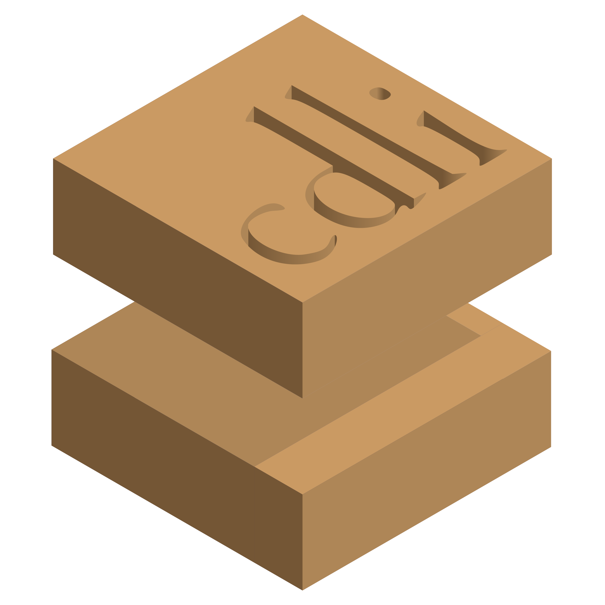

#  Framework API Client

Client for CDLI framework API.

  - [Install](#install)
  - [Getting started](#getting-started)
    - [Command-Line Interface](#command-line-interface)
    - [Programming Interface](#programming-interface)

## Install

A prerequisite for this client is [Node.JS](https://nodejs.org/en/) and a package
manager like [npm](https://npmjs.com), which usually comes with it.

    npm install -g cdli-api-client

Or install it locally into an existing project:

    npm install cdli-api-client

Alternatively, the command can be run with [npx](https://www.npmjs.com/package/npx):

    npx cdli-api-client --help

## Getting started

Right now, the client supports two basic operations:

  - [exporting](#export) parts of the database as linked data (or specifically
    N-Triples). The parts that can be chosen are the types of entities in the
    catalogue, such as artifacts, materials, proveniences, inscriptions and periods.
  - [searching](#search) artifacts in the database.

### Command-Line Interface

    cdli [command]

    Commands:
      cdli export  Export catalog and text data
      cdli search  Export catalog and text data

    Options:
      --version          Show version number                               [boolean]
      --host, -h         Host URL to use for API calls
                                           [string] [default: "https://cdli.earth/"]
      --format, -f       File format
                      [choices: "ndjson", "csv", "tsv", "ntriples", "bibtex", "atf"]
      --output-file, -o  Output file (outputs to stdout by default)
      --help             Show help                                         [boolean]

#### Export

    cdli export

    Export catalog and text data

    Options:
          --version      Show version number                               [boolean]
      -h, --host         Host URL to use for API calls
                                           [string] [default: "https://cdli.earth/"]
      -f, --format       File format
               [choices: "ndjson", "csv", "tsv", "ntriples", "ttl", "bibtex", "atf"]
      -o, --output-file  Output file (outputs to stdout by default)
          --help         Show help                                         [boolean]
      -e, --entities     Which types of entities to fetch
      [array] [choices: "abbreviations", "archives", "artifacts", "artifact-assets",
                              "artifacts-external-resources", "artifacts-materials",
          "entities-external-resources", "entities-names", "authors", "collections",
            "dynasties", "external-resources", "genres", "inscriptions", "journals",
       "languages", "locations", "materials", "material-aspects", "material-colors",
           "periods", "places", "proveniences", "publications", "regions", "rulers"]
                                                                       [default: []]
      -i, --index        Which index(es) to fetch              [array] [default: []]

So to export place-related entities from a locally-running framework instance you
could do this:

    cdli export \
      --host http://localhost:2354/ \
      --entities archives proveniences regions \
      --output-file places.nt

Fetching all artifacts from the live server could look like this:

    cdli export \
      --host https://cdli.earth/ \
      --entities artifacts \
      --format csv \
      --output-file artifacts.csv

Export all linked data:

    cdli export \
      --host https://cdli.earth/ \
      --entities abbreviations archives artifacts artifact-assets \
        artifacts-external-resources artifacts-materials authors collections \
        dynasties entities-external-resources entities-names external-resources \
        genres inscriptions journals languages locations materials material-aspects \
        material-colors periods places proveniences publications regions rulers \
      --format ntriples \
      --output-file all.nt

#### Resuming exports

Use `--checkpoint` to start an export that can be resumed. Both the output and
checkpoint paths must be new files; existing files are never overwritten:

```sh
cdli export --entities inscriptions --format atf \
  --output-file inscriptions.atf --checkpoint inscriptions.progress.json
```

If the command is interrupted or reports an error, repeat it with `--resume`
instead of `--checkpoint`, keeping the host, format, entities (in the same order),
and output path identical:

```sh
cdli export --entities inscriptions --format atf \
  --output-file inscriptions.atf --resume inscriptions.progress.json
```

Progress is saved after each complete page is written and flushed to disk. Resume
verifies the saved output using a SHA-256 checksum and requests the next page.
If the output contains bytes beyond the checkpoint, it first saves a full copy
to a new `<output>.recovery-<random>` file, then removes the uncommitted bytes
from the working output. The CLI prints the backup path; library callers can
listen for the `recoveryBackup` event (`{ path }`). The backup is retained so
an incorrect or tampered checkpoint cannot silently destroy the original data.
Creating a backup requires enough free space for a second copy of the output;
if it fails, recovery stops before changing the output. It reads the saved portion
of the local output once to verify it. A completed checkpoint is retained, and
resuming it does not download the data again. Errors exit with status 1.

Checkpoint exports require an output file; stdout is not supported. Keep the
checkpoint and output together without editing them. Checkpoints are trusted
local state; their checksum detects output corruption, not checkpoint tampering.
Run only one export per
checkpoint/output pair at a time. Multiple entities are downloaded sequentially;
their output is concatenated as with ordinary exports. For CSV/TSV, export each
entity type separately because their columns may differ.

Resume uses the API's pagination links. It does not freeze the server's dataset:
if records or pagination change between runs, restart with new output and
checkpoint paths. This feature does not provide a total record count or an
arbitrary record offset. In particular, artifact counts and ATF transliteration
counts are not interchangeable.

Pagination links and HTTP redirects must remain on the configured host's origin
(the same scheme, hostname, and port). Cross-origin destinations, including
HTTPS-to-HTTP downgrades, are rejected before sending session credentials.

The JavaScript client accepts the same options in a fourth argument:

```js
await client.export('atf', ['inscriptions'], 'inscriptions.atf', {
    checkpoint: 'inscriptions.progress.json'
})
// After an interruption, in a new process:
await client.export('atf', ['inscriptions'], 'inscriptions.atf', {
    resume: 'inscriptions.progress.json'
})
```

#### Search

    cdli search

    Search artifacts in the catalog

    Simple search:
      -q, --query                Search query                                [array]
          --queryCategory, --qc  Search category
            [array] [choices: "keyword", "publication", "collection", "provenience",
                                   "period", "transliteration", "translation", "id"]
          --queryOperator, --qo  Search operator      [array] [choices: "AND", "OR"]

    Advanced search:
          --advancedField, --af  Search field                                [array]
          --advancedQuery, --aq  Search query                                [array]

    Filter:
          --filterField, --fk  Filter by field                               [array]
          --filterValue, --fv  Filter by value                               [array]

    Options:
          --version      Show version number                               [boolean]
      -h, --host         Host URL to use for API calls
                             [string] [default: "https://cdli.earth/"]
      -f, --format       File format
                      [choices: "ndjson", "csv", "tsv", "ntriples", "bibtex", "atf"]
      -o, --output-file  Output file (outputs to stdout by default)
          --help         Show help                                         [boolean]

Example:

    cdli search -q holland --fk genre --fv "Official or display" -f tsv


### Programming Interface

```js
const CDLI = require('cdli-api-client')

const client = new CDLI.Client('http://localhost:2354/')

// process logging
client.on('log', msg => process.stderr.write(msg))

client.export(['archives', 'proveniences', 'regions' ], 'places.nt')
    .then(entities => {
        for (const { status, reason } of entities) {
            if (status === 'rejected') {
                console.error(reason)
            }
        }
    })
```
